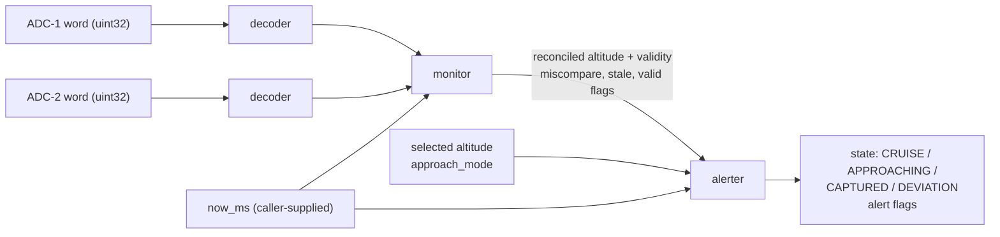
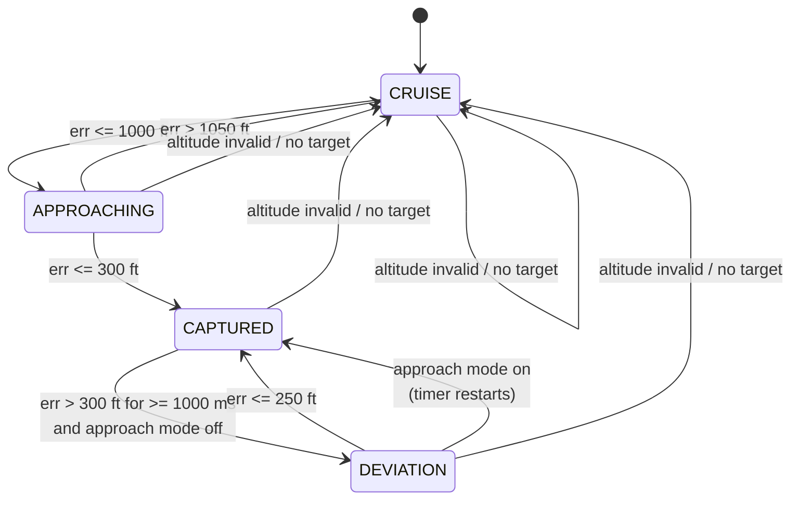

# AIM-VV: Altitude Indication Monitor, Verification & Validation

A requirements-based verification and validation (V&V) exercise for a small avionics-style
function: a **PFD altitude alerting and cross-side miscompare monitor** ("AIM"). It is
developed and verified following an ARP4754B / ARP4761A / DO-178C-style process (hazard
analysis, requirements, design, test, coverage, traceability, change control), scaled down
for a single engineer and a single board.

The point of the repository is the **evidence trail**, not the function itself: every
requirement is traced to tests, the tests are measured for adequacy, and the claims are
reproducible with one command each.

> **Status:** Phases 0-9 are done. Phase 7 (processor-in-the-loop) has firmware and a harness
> that compile and pass against a *simulated* target, but **has not yet been run on real
> hardware**. Phase 10 uses a Python reference model because MATLAB/Stateflow was not
> available. See [Status](#status) and [Limitations](#limitations).

---

## Contents

1. [What AIM does](#what-aim-does)
2. [How it works](#how-it-works)
3. [Quick start](#quick-start)
4. [Repository layout](#repository-layout)
5. [Verification evidence](#verification-evidence)
6. [Running on hardware (Phase 7)](#running-on-hardware-phase-7)
7. [Scripts reference](#scripts-reference)
8. [Requirements, safety and process documents](#requirements-safety-and-process-documents)
9. [Design decisions](#design-decisions)
10. [Status](#status)
11. [Limitations](#limitations)
12. [Troubleshooting](#troubleshooting)
13. [Making changes](#making-changes)

---

## What AIM does

AIM ingests ARINC 429 label-203 altitude words from two independent air data computers
(ADC-1 and ADC-2) plus a pilot-selected target altitude and an approach-mode flag. It produces:

- **Altitude alerting**
  - An *approaching altitude* indication when the aircraft is within the approach band of
    the selected altitude.
  - A *deviation* alert if a captured altitude is subsequently departed for too long. The
    deviation alert is suppressed while approach mode is active.
- **Cross-side monitoring**
  - A latched *miscompare* flag when the two channels disagree by more than a threshold for
    longer than a persistence time (and a matching persistence time to clear it).
  - Per-channel *staleness* detection.
  - Automatic *fail-over* to the remaining valid channel, so one failed channel does not
    disable alerting.

"ADC" here means **air data computer**, not an analog-to-digital converter. Both channels are
*simulated in software* by the test station; no altitude sensor or ARINC 429 bus is used.

## How it works

### Data flow



The whole function is one call, `aim_step`, which decodes both words, runs the monitor to
reconcile an altitude, then runs the alerter against it.

### ARINC 429 label-203 word (simplified in-memory format)

| Bits | Field | Notes |
|---|---|---|
| 0-7 | Label | Must be `0203` octal (`0x83`) |
| 8-9 | SDI | Informational |
| 10-27 | Altitude | 18-bit two's complement BNR, 1 ft per LSB |
| 28-29 | SSM | `00` Failure Warning, `01` No Computed Data, `10` Functional Test, `11` Normal Operation |
| 30 | Spare | Not checked |
| 31 | Parity | Odd parity over the whole word |

Worked example: `0x309C4183` = label 0203, SDI 1, SSM Normal, **+10000 ft**.
See [`docs/icd/ICD.md`](docs/icd/ICD.md) for the authoritative definition.

### Alerter state machine



`err` is `|altitude - selected|`. The machine advances at most one state per call.

### Tunable parameters

All thresholds live in [`src/aim_params.h`](src/aim_params.h), the single source of truth.

| Parameter | Value | Meaning |
|---|---|---|
| `AIM_APPROACH_BAND_FT` | 1000 | CRUISE to APPROACHING |
| `AIM_CAPTURE_BAND_FT` | 300 | APPROACHING to CAPTURED |
| `AIM_DEVIATION_BAND_FT` | 300 | Start of deviation timing |
| `AIM_HYSTERESIS_FT` | 50 | Anti-chatter margin at band edges |
| `AIM_DEVIATION_PERSIST_MS` | 1000 | Deviation must persist this long |
| `AIM_MISCOMPARE_THRESHOLD_FT` | 200 | ADC-1 vs ADC-2 difference limit |
| `AIM_MISCOMPARE_PERSIST_MS` | 2000 | To latch, and again to clear |
| `AIM_CHANNEL_STALE_MS` | 500 | No good sample for this long means stale |
| `AIM_MIN_ALT_FT` / `AIM_MAX_ALT_FT` | -1000 / 50000 | Valid altitude range |

### Coding constraints

C99, `-Wall -Wextra -Werror`, fixed-width integer types only, **no dynamic memory, no I/O, no
clock reads**. Time is an explicit `now_ms` parameter so behaviour is deterministic on the host
and on the target, independent of call rate and safe across 32-bit counter wraparound.

---

## Quick start

Prerequisites: `gcc`, `cmake` (3.16+), Python 3.9+. Optional: `arduino-cli` (firmware build).

```bash
git clone https://github.com/ISHMAEL555/aim-vv.git && cd aim-vv

cmake -S . -B build -DCMAKE_BUILD_TYPE=Debug
cmake --build build

python3 -m venv .venv
.venv/bin/pip install pytest pytest-cov gcovr
.venv/bin/python -m pytest tests -q          # 237 tests
```

Run the full verification gate (strict build, static analysis, tests, 100% coverage):

```bash
scripts/check.sh
```

Run the processor-in-the-loop harness without any hardware (host-simulated target):

```bash
.venv/bin/python scripts/pil.py --sim
```

---

## Repository layout

```
src/                         The verified core (C99, no hardware dependency)
  aim_params.h                 Compile-time thresholds
  aim_types.h                  Public types / C ABI
  decoder.{h,c}                ARINC 429 label-203 word decode
  monitor.{h,c}                Cross-side miscompare, staleness, reconciliation
  alerter.{h,c}                Approach / capture / deviation state machine
  aim.{h,c}                    Top-level API (aim_init, aim_step)
target/aim_target/           Phase 7 Arduino UNO firmware
  aim_target.ino               Thin shell around aim_step
  framer.{h,c}                 UART frame parser (also built for the host and tested)
  src -> ../../src             Symlink so the sketch compiles the same core sources
tests/
  unit/                        One file per module; each test cites the HLR it verifies
  integration/                 Scenarios through aim_step (SYS tags), PIL sim, back-to-back
  model/aim_model.py           Independent Python reference model (written from the HLRs)
  vectors/                     Shared JSON decoder vectors
  aim_ctypes.py, conftest.py   ctypes bindings and Python reference encoders
reqs/
  system.sdoc                  System requirements SYS-1..10
  hlr.sdoc                     High-level requirements HLR-* with parent links
docs/
  safety/FHA.md, FTA.md        Hazard assessment and fault tree
  icd/ICD.md                   Interface control document (bit layout, UART framing, API)
  process/                     PLAN.md, VERIFICATION_SUMMARY.md, CHANGE_LOG.md
  trace/TRACEABILITY.md        Generated requirements-to-tests matrix
  verification/                Generated SEEDED_DEFECTS.md, PIL_RESULTS.md
scripts/                     check.sh, trace.py, mutate.py, build_target.sh, pil.py
.github/workflows/ci.yml     CI: gate, trace, mutation, PIL-sim, AVR build
CMakeLists.txt               Builds libaim and libaimframer shared libraries (for ctypes)
```

---

## Verification evidence

Each row can be regenerated with the command shown. Numbers are from the last full run.

| Objective | Result | Command |
|---|---|---|
| Tests | **237 pass** | `.venv/bin/python -m pytest tests` |
| Structural coverage | **100 % line and branch** on all core and framer sources | `scripts/check.sh` |
| Static analysis | Clean under `-Wall -Wextra -Werror -Wconversion -Wshadow -pedantic` and `gcc -fanalyzer` | `scripts/check.sh` |
| Traceability | 10 SYS, 28 HLR, **0 gaps** | `.venv/bin/python scripts/trace.py --check` |
| Test adequacy | **39/39 seeded defects killed** | `.venv/bin/python scripts/mutate.py` |
| Independent model | 150 random seeds x 400 cycles identical to C, including 32-bit time wrap | `tests/integration/test_back_to_back.py` |
| AVR build | Compiles clean for UNO: 5.7 KB flash (17 %), 371 B RAM (18 %) | `scripts/build_target.sh` |
| PIL, simulated target | 4/4 scenarios match the host cycle-by-cycle | `scripts/pil.py --sim` |
| **PIL, real hardware** | **Not run yet** | see below |

### What each layer of testing adds

- **Unit tests** verify each high-level requirement (HLR) at boundaries (exactly at, and one
  unit either side of, every threshold), plus invalid SSM, bad label, bad parity, dropouts,
  out-of-range selected altitude, and a deliberately corrupted state byte.
- **Integration tests** drive `aim_step` through full scenarios (climb, capture, deviation,
  miscompare, channel loss) and a corrupted UART stream.
- **Seeded defects (mutation testing)** inject 39 deliberate faults into a scratch copy of
  the source. Every one must make a test fail; a survivor means a requirement is not really
  verified. This campaign found one genuine gap (see below).
- **Back-to-back model** runs the C code and an independently written Python model on random
  stimulus and compares every output each cycle.
- **Target-compiler build** catches defects that host builds cannot (16-bit `int` on AVR).

### Findings the process produced

1. **Real defect, AVR only.** `1u << 17` in the decoder overflows because `unsigned int` is
   16 bits on the UNO, so altitude would have decoded wrongly on the board while every host
   test passed. Found by the first AVR compile; fixed with `UINT32_C(1)` (CR-002) and now
   guarded by `scripts/build_target.sh`, which fails on any project warning for the target.
2. **Test gap.** Seeded defect M13 showed that a stale divergence flag could re-latch the
   miscompare instantly after a clear, and no test noticed. A test now covers it.
3. **Dead code.** Redundant "not stale" conditions in the monitor were unreachable (a channel
   that is good this cycle cannot be stale) and were removed rather than waived (CR-001).

Full details: [`docs/process/CHANGE_LOG.md`](docs/process/CHANGE_LOG.md).

---

## Running on hardware (Phase 7)

### Rig

- **Device under test:** Arduino UNO over USB (`/dev/ttyACM0`, 115200 baud): carries ADC-1,
  selected altitude, approach mode and step commands.
- **Test station:** a laptop **or a Raspberry Pi 4**, running `scripts/pil.py`.
- **ADC-2 link:** 38400 baud into UNO pin 10 (`SoftwareSerial`), independent of USB. Any one
  of these sources works:

| Source | Wiring | `--adc2` argument |
|---|---|---|
| Pi 4 hardware UART | Pi pin 8 (GPIO14 TXD) to UNO pin 10; Pi pin 6 (GND) to UNO GND | `/dev/serial0` |
| USB-serial adapter (CP2102, FT232, CH340) | adapter TXD to UNO pin 10; GND to GND | `/dev/ttyUSB0` |
| Arduino Nano as adapter (empty sketch uploaded) | Nano RX0 to UNO pin 10; GND to GND | `/dev/ttyUSB0` |

**Never connect a UNO TX pin or any 5 V pin to a 3.3 V device (Pi, CP2102).** Connect only
TX-to-pin-10 and GND. Each board is powered from its own USB cable.

**Raspberry Pi 4 one-time setup:** `sudo raspi-config` > Interface Options > Serial Port:
login shell **No**, serial hardware **Yes**. Add `dtoverlay=disable-bt` to
`/boot/firmware/config.txt` and reboot; `/dev/serial0` should then exist.
**WSL2 laptops** cannot see USB devices without `usbipd-win`.

**Nano as adapter:** upload an empty sketch (`void setup(){} void loop(){}`) with
`arduino-cli ... --fqbn arduino:avr:nano:cpu=atmega328old` (use `atmega328` for newer
Nanos) so nothing on the Nano drives the pins.

### Flash and run

```bash
arduino-cli compile --fqbn arduino:avr:uno target/aim_target
arduino-cli upload -p /dev/ttyACM0 --fqbn arduino:avr:uno target/aim_target

.venv/bin/pip install pyserial
.venv/bin/python scripts/pil.py --port /dev/ttyACM0 --adc2 /dev/serial0 --report
```

### UART protocol (summary)

Frame: `0xAA | TYPE | 4-byte little-endian payload | checksum`, where
`(TYPE + payload + checksum) mod 256 == 0`.

| TYPE | Name | Link | Payload |
|---|---|---|---|
| `0x01` | ADC1_WORD | USB | ARINC word |
| `0x02` | SELECTED_ALT | USB | altitude in ft, `0x7FFFFFFF` means no target |
| `0x03` | ADC2_WORD | secondary | ARINC word |
| `0x04` | STEP | USB | `now_ms`; runs one `aim_step` |
| `0x05` | APPROACH_MODE | USB | 0 or 1 |

Time comes from the host in the STEP frame, not from `millis()`, so a hardware run is
deterministic and comparable cycle-by-cycle with the host build. After each step the firmware
prints one status line (`S,now_ms,state,approaching,deviation,miscompare,...,rejected`).
Full definition: [`docs/icd/ICD.md`](docs/icd/ICD.md) section 3.

### Closing Phase 7

After a passing hardware run, `docs/verification/PIL_RESULTS.md` will record "hardware" as the
run mode. Then update the "NOT RUN" row in
[`docs/process/VERIFICATION_SUMMARY.md`](docs/process/VERIFICATION_SUMMARY.md), the Phase 7
row below, and log any firmware or harness fixes in the change log.

---

## Scripts reference

| Script | Purpose |
|---|---|
| `scripts/check.sh` | Strict build, `gcc -fanalyzer`, tests on a coverage build, 100 % line and branch gate; HTML report in `build-cov/report/` |
| `scripts/trace.py [--check]` | Builds `docs/trace/TRACEABILITY.md` from `.sdoc` files, test docstrings and source comments; `--check` fails on any gap |
| `scripts/mutate.py` | Seeded-defect campaign on a scratch copy of the source; writes `docs/verification/SEEDED_DEFECTS.md`; exits non-zero on any survivor |
| `scripts/build_target.sh` | Compiles the firmware for the UNO; fails on any warning from project code |
| `scripts/pil.py` | PIL harness: `--sim` (host-emulated target) or `--port/--adc2` (hardware); `--report` writes `docs/verification/PIL_RESULTS.md` |

CMake options: `-DAIM_COVERAGE=ON` (gcov instrumentation), `-DAIM_STRICT=ON` (extra warnings).
Environment: `AIM_LIB` and `AIM_FRAMER_LIB` point the tests at alternative builds (used by the
coverage and mutation runs).

CI (`.github/workflows/ci.yml`) runs the gate, the traceability check, the mutation campaign,
the simulated PIL, and the AVR build.

---

## Requirements, safety and process documents

| Document | Contents |
|---|---|
| [`docs/safety/FHA.md`](docs/safety/FHA.md) | Failure conditions FC-01..06, severity, DAL, derived safety requirements SR-1..4 |
| [`docs/safety/FTA.md`](docs/safety/FTA.md) | Fault tree for FC-03 (undetected miscompare), mitigations, residual risks |
| [`docs/icd/ICD.md`](docs/icd/ICD.md) | Word layout, UART framing, C API, parameter table |
| [`reqs/system.sdoc`](reqs/system.sdoc), [`reqs/hlr.sdoc`](reqs/hlr.sdoc) | SYS-1..10 and HLR requirements (StrictDoc format) |
| [`docs/trace/TRACEABILITY.md`](docs/trace/TRACEABILITY.md) | Generated SYS to HLR to test matrix |
| [`docs/process/PLAN.md`](docs/process/PLAN.md) | Development and verification plan |
| [`docs/process/VERIFICATION_SUMMARY.md`](docs/process/VERIFICATION_SUMMARY.md) | Evidence summary and limitations |
| [`docs/process/CHANGE_LOG.md`](docs/process/CHANGE_LOG.md) | Change records CR-001..005 with impact analysis |

The function is assessed at **DAL B** (highest failure conditions are Hazardous). Requirement
IDs are cited in test docstrings so traceability is machine-checked rather than hand-kept.

---

## Design decisions

- **Explicit time (`now_ms`).** Makes every persistence and staleness computation a pure
  function of inputs and prior state: deterministic, replayable, and unaffected by call rate.
- **Core in `src/`, I/O in `target/`.** The verified logic has no hardware dependency, so the
  same code is tested on a laptop and flashed to the board.
- **Python `ctypes` over a shared library.** Tests exercise the real C ABI, with an
  independently written Python encoder as the oracle for the word layout.
- **Frozen timers when a channel is unusable.** Required behaviour (HLR-MON-05); it means a
  flapping channel can delay a miscompare latch (residual risk A3 in the FTA).
- **Host-supplied time in PIL.** Removes timing nondeterminism from hardware comparison.
- **Remove, don't waive, unreachable code.** Dead branches are deleted with a written
  equivalence argument rather than excluded from coverage.

---

## Status

| Phase | Status |
|---|---|
| 0 Foundation (FHA, ICD, requirements) | done |
| 1 C core | done |
| 2 Unit tests | done |
| 3 Integration tests | done |
| 4 Coverage, static analysis, CI | done (100 % line/branch) |
| 5 Traceability | done (0 gaps) |
| 6 Seeded defects | done (39/39 killed) |
| 7 Processor-in-the-loop | firmware and harness done, AVR build clean, sim passes; **hardware run pending** |
| 8 Process documents | done |
| 9 Change control | done |
| 10 Model | Python reference model back-to-back (no MATLAB/Stateflow available) |

## Limitations

- **Hardware PIL has not been executed.** The firmware only compiles. `--sim` validates the
  harness and protocol using the host C code; it says nothing about AVR runtime behaviour.
- **Known rig risk.** `SoftwareSerial` reception at 38400 baud disables interrupts for about
  260 microseconds per byte, while the USB UART receives a byte every 87 microseconds at 115200
  baud. Bytes on the USB link may be dropped during ADC-2 reception. The framer rejects corrupt
  frames and reports them in the `rejected` field; if it is non-zero, lower the USB baud rate
  or pace writes.
- **Decision coverage, not MC/DC.** DAL B nominally calls for MC/DC; it was not measured.
- **Phase 10 is a stand-in.** The Python model is written from the HLR text; it gives no model
  coverage or code-generation evidence, and shares the author's reading of the requirements.
- **Mutation operators are hand-picked** (39), not exhaustive.
- **No independent reviewer.** Tooling (oracles, mutation) stands in for independence.
- **Static analysis is gcc-only**; cppcheck and clang-tidy were not available.
- **FTA residual risks** (intermittent dropouts postponing a latch; no integrity protection on
  monitor state) are documented, not fixed.

## Troubleshooting

| Symptom | Likely cause and fix |
|---|---|
| `libaim shared library not found` | Build first: `cmake -S . -B build && cmake --build build` |
| `scripts/check.sh` cannot find pytest/gcovr | `python3 -m venv .venv && .venv/bin/pip install pytest gcovr` |
| `scripts/build_target.sh`: `arduino-cli: not found` | Install `arduino-cli`, then `arduino-cli core install arduino:avr` |
| No `/dev/ttyACM0` or `/dev/ttyUSB0` on WSL2 | Attach the device with `usbipd-win`; check `ls /dev/ttyACM* /dev/ttyUSB*` |
| USB works but ADC-2 stays invalid | Check the TX-to-pin-10 wire and common GND; confirm `--adc2` points at the right port |
| `rejected` count above zero in PIL | Byte loss on the rig (see Limitations); lower the baud rate or add pacing |
| Upload fails with a sync error on a Nano | Switch `cpu=atmega328old` to `cpu=atmega328` or the reverse |
| Charge-only USB cable | The board powers up but no serial port appears; use a data cable |

## Making changes

1. Record the change in [`docs/process/CHANGE_LOG.md`](docs/process/CHANGE_LOG.md): reason,
   affected requirements, impact analysis.
2. Tag new tests with the requirement they verify, in the test docstring (`HLR-XXX-NN`).
3. Run `scripts/check.sh`, `trace.py --check`, `mutate.py` and `build_target.sh` before
   committing. All must pass.
4. If a seeded defect survives, the tests are inadequate; add tests, don't remove the mutant.
