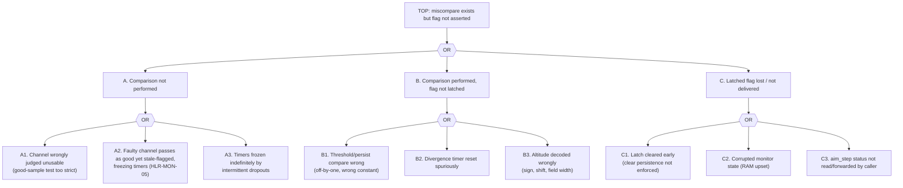

# Fault Tree Analysis — FC-03 (Undetected cross-side altitude miscompare)

FC-03 is the highest-severity failure condition in the [FHA](FHA.md) (Hazardous, DAL B).
Top event: **ADC-1 and ADC-2 disagree by more than `AIM_MISCOMPARE_THRESHOLD_FT` for longer
than `AIM_MISCOMPARE_PERSIST_MS`, and the `miscompare` output is not asserted.**

## Basic events, mitigations and evidence

| Event | Mitigation | Verification evidence |
|---|---|---|
| A1 | Good-sample criterion is exactly `valid && SSM == Normal` (HLR-MON-01) | `test_invalid_or_wrong_ssm_is_not_good`; mutant M09 killed |
| A2 | A stale channel cannot be "good" in the same cycle (good ⇒ `last_good == now`); stale is reported (SR-2) | `test_staleness_exact_boundary`, `test_ch2_staleness_and_ch1_stale_failover`; mutant M10 killed |
| A3 | **Residual risk — see below.** Frozen timers (HLR-MON-05) are required behaviour, so a channel that alternates good/bad faster than `AIM_CHANNEL_STALE_MS` can postpone a latch indefinitely | `test_timers_frozen_when_a_channel_is_unusable`; mutant M16 killed (verifies the *specified* behaviour only) |
| B1 | Boundary tests at exactly threshold and persist, ±1 | `test_miscompare_at_exact_threshold_does_not_latch`, `test_miscompare_requires_full_persistence`; mutants M11, M12 killed |
| B2 | Divergence timer resets only when difference ≤ threshold | back-to-back model (150 seeds); `test_latched_miscompare_reconverge_timer_restarts` |
| B3 | Decoder vectors incl. ICD worked example; sign-extension tests; **AVR 16-bit-int shift defect found and fixed (CR-002)** | `test_decoder_vectors`, `test_sign_extension_most_negative`; mutants M02–M05 killed; `scripts/build_target.sh` |
| C1 | Clear requires full persistence below threshold (HLR-MON-04), and divergence state is cleared on latch | `test_miscompare_clear_requires_full_persistence`, `test_rediverge_after_clear_needs_full_persistence_again`; mutants M13, M14, M15 killed |
| C2 | **Not mitigated in the core**; alerter has a defensive reset of an out-of-range state byte, monitor does not. Mitigation belongs to the platform (RAM integrity / watchdog) | `test_corrupted_state_recovers_to_cruise` (alerter only) |
| C3 | Out of scope for this function; caller-integration concern | `test_corrupted_link_does_not_disturb_valid_data_path`, PIL scenarios |

## Common-cause considerations

ADC-1 and ADC-2 words share one decoder and one monitor. A decoder defect (B3) can therefore
corrupt both channels *identically* and mask a real disagreement — the comparison then sees
agreement. This is why decoder correctness carries the heaviest verification weight
(vectors, mutation, target-compiler build, Python reference encoder as an independent oracle),
and why the Phase 7 AVR build is part of the evidence rather than optional.

## Residual risks / limitations

1. **A3 (intermittent dropout masking).** Accepted by design (HLR-MON-05), but it means
   miscompare detection can be delayed under a flaky channel. A future requirement could bound
   total frozen time and annunciate a channel-fault instead.
2. **C2.** No integrity protection on `aim_monitor_state_t`.
3. Probabilities are not quantified; this tree is qualitative.
